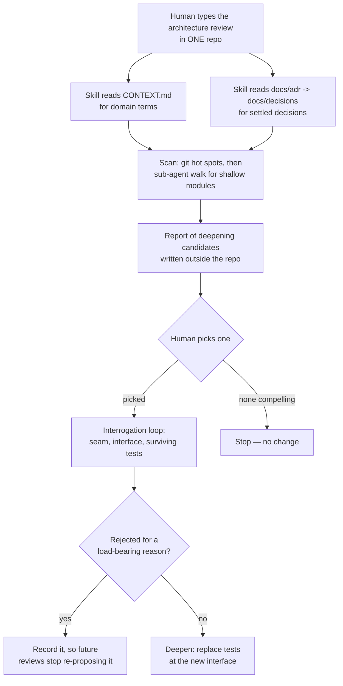

# ADR-038: Code-architecture domain — the deep-module vocabulary as the family's shared design language, with an invoked per-repo review

## Context

The nxtlvl family is five repositories: the `nxtlvl-marketplace` root (an install manifest) and
four independently-versioned source repos nested inside it. Until now the family has had a rich
vocabulary for its *capability* surfaces — skills, commands, agents, hooks, all governed by
[ADR-030](ADR-030-skill-design-and-canonical-format.md) and
[ADR-032](ADR-032-agent-creation-process.md) — and no shared vocabulary at all for the
*executable code* those surfaces sit on. Discussions about the code drift between "component",
"service", "module", "API", "boundary", and "layer", with no agreement on which word means what.
That imprecision costs most where the family is weakest: the code is a minority of every repo,
so it gets designed in short bursts, months apart, with no continuity of language between them.

The family's actual code mass, measured against tracked files (excluding `node_modules`):

| Repo | Code files | Densest clusters |
|---|---|---|
| `nxtlvl-marketplace` (root) | 0 | — (16 markdown, 3 JSON) |
| `nxtlvl-core` | ~99 | `plugins/nxtlvl/lib/harness-registry` (26), `plugins/nxtlvl/lib` (25), `plugins/nxtlvl/hooks` (18) |
| `nxtlvl-lab` | ~350 | `labs-app/ui/src/views` (62), `labs-app/server/src` (61), `harness-lab/packages/lab-core/src` (28) |
| `nxtlvl-wiki` | ~97 | `plugins/nxtlvl-wiki/scripts` (38), `mcp/src` + `mcp/test` (~24), `analytics` (18) |
| `nxtlvl-monitor` | 7 (shell) | `scripts` (4), `tests` (3) |

Matt Pocock's `mattpocock-skills` plugin supplies a ready-made answer in two pieces that this
record adopts and wires:

- **`codebase-design`** is a *vocabulary* skill. It defines seven terms and four principles and
  produces no artifact. Its `description` is broad, so any model may pull it in whenever design
  language is needed.
- **`improve-codebase-architecture`** is the *workflow* that consumes that vocabulary — it scans
  for shallow modules, writes a self-contained report of deepening candidates, and runs an
  interrogation loop on whichever one the human picks. It carries
  `disable-model-invocation: true`, so it is absent from the model-facing skill list and can
  only be started by a human typing it.

Two mismatches block the workflow from running against this family as-is. It reads a domain
glossary from `CONTEXT.md`, which no repo here has (two repos have `AGENTS.md`, a different
artifact serving a different purpose). And it reads prior decisions from `docs/adr/`, whereas
the family standard — set by the global decision rule and honoured by four repos — is
`docs/decisions/`. Left unreconciled, a review would name modules after file paths instead of
domain concepts, and would cheerfully re-propose refactors that existing records already reject.

## Decision

**The deep-module vocabulary is the family's shared language for code architecture, and
architecture review is a human-invoked, per-repo act — never a family-wide sweep.**

### 1. The vocabulary is adopted verbatim, and it is binding

Seven terms, used exactly, in every persisted discussion of code structure — records, specs,
plans, reviews, commit bodies, and code comments:

**Module** — anything with an interface and an implementation; deliberately scale-agnostic (a
function, a class, a package, a slice spanning tiers). **Interface** — everything a caller must
know to use the module correctly: not just the type signature but the invariants, ordering
constraints, error modes, required configuration, and performance characteristics.
**Implementation** — what is inside the module. **Depth** — leverage at the interface: how much
behaviour a caller or test can exercise per unit of interface it must learn; deep means a lot of
behaviour behind a small interface, shallow means an interface nearly as complex as what is
behind it. **Seam** (Michael Feathers) — a place where behaviour can be altered without editing
in that place; the *location* where an interface lives. **Adapter** — a concrete thing
satisfying an interface at a seam; names a role, not a substance. **Leverage** and **Locality**
— what depth buys, respectively, for callers (more capability per unit of interface learned) and
for maintainers (change, bugs, and verification concentrate in one place).

The avoid-list is part of the adoption, not decoration: **do not** substitute *component*,
*service*, or *signature*, and do not say *boundary* when *seam* or *interface* is meant —
"boundary" is already spoken for by domain-driven design's bounded context.

Four principles travel with the terms: depth is a property of the *interface*, not the
implementation; the **deletion test** (imagine deleting the module — if complexity vanishes it
was a pass-through, if it reappears across callers it was earning its keep); the interface *is*
the test surface; and **one adapter means a hypothetical seam, two means a real one**.

This record adopts depth-as-leverage and explicitly rejects Ousterhout's depth-as-ratio
(implementation lines over interface lines), which rewards padding the implementation.

### 2. The vocabulary governs code only

It applies to executable code — TypeScript, JavaScript, Python, shell. It does **not** apply to
the markdown capability surfaces, which already have their own governing records and their own
established language: skills under ADR-030, agents under ADR-032. A skill is not a "module" and
its frontmatter is not an "interface". Keeping the two vocabularies apart is the point;
collapsing them would make both vaguer.

### 3. Review is invoked, per-repo, in leverage order

Order is set by where the leverage is, which is where the code mass is: **`nxtlvl-lab` →
`nxtlvl-core` → `nxtlvl-wiki`**. `nxtlvl-lab` goes first because it holds the family's only real
application (`labs-app`) rather than a collection of scripts.

Two repos are **out of scope**: the `nxtlvl-marketplace` root, which has no code to analyse at
all, and `nxtlvl-monitor`, whose seven shell scripts are below the threshold where deepening
repays the effort. The root repo hosts the *convention*; it never hosts the *scan*.

There is no family-wide run. A single review spanning repos would cross four independent version
histories and produce candidates nobody can land in one change.

### 4. `CONTEXT.md` is its own file, at the root of each in-scope repo

Not folded into `AGENTS.md`. Three reasons: the workflow reads that filename specifically, so
folding it in means it silently finds nothing; `AGENTS.md` addresses agents operating in the repo
while `CONTEXT.md` is a domain glossary for humans and models designing the code — different
audiences, different lifecycles; and the file is read on demand by a skill rather than injected
every session, so it costs nothing against the context-assembly budget that
[ADR-008](ADR-008-context-assembly.md) governs. The pointers-over-content policy constrains
always-on context, and `CONTEXT.md` is not always-on.

`CONTEXT.md` is seeded now for the three in-scope repos and maintained thereafter as a side
effect of review: a deepened module named after a concept not yet in the glossary adds the term
at the moment of naming.

### 5. The decision-path mismatch is fixed by a symlink, not a fork

Each in-scope repo gets `docs/adr` as a symbolic link to `docs/decisions`. The family standard
path stays authoritative and unmoved; the upstream skill finds what it expects; and the fix
costs one inode per repo and survives every upstream version bump.

Vendoring the skill into the `nxtlvl` plugin with the path corrected was the alternative, and it
is what the family already does for `documentation-and-adrs`. Rejected here: vendoring is a
maintenance fork, justified when the house *substance* diverges from upstream. Here the
substance is adopted unchanged and only a path differs — the cheapest reversible fix wins, and
the symlink additionally helps any other tool that assumes the conventional `docs/adr/`.

## Alternatives Considered

- **Run the review family-wide from the root repo.** The original shape of this plan. Fails on
  contact with the facts: the root repo is gitignoring all four source repos and holds no code,
  so there is nothing at that level to scan. Inverting it — convention at the root, scans in the
  children — is what this record does.
- **Adopt only the vocabulary, skip the review workflow.** Cheap, and would still improve how the
  code gets discussed. Rejected because a vocabulary nobody exercises decays into a glossary file
  nobody opens; the periodic review is what keeps the terms in working memory.
- **Fold `CONTEXT.md` into `AGENTS.md`.** Fewer files per repo, and superficially consistent with
  keeping context lean. Rejected in §4 — the skill would not find it, and the two files serve
  different readers.
- **Vendor `improve-codebase-architecture` into the `nxtlvl` plugin with the path corrected.**
  Rejected in §5 — a maintenance fork bought nothing a symlink does not.
- **Extend the vocabulary to skills and agents too, for one language across the family.**
  Superficially attractive; rejected in §2. The two domains have genuinely different shapes, and
  a term stretched to cover both stops discriminating in either.
- **Ousterhout's depth-as-ratio.** Rejected upstream and re-rejected here: measuring depth as
  implementation lines over interface lines rewards a bloated implementation, which is the
  opposite of the intent.
- **Include `nxtlvl-monitor`.** Seven shell scripts. Completeness is not a reason; revisit if it
  grows.

## Consequences

- **The review can never fire on its own.** `disable-model-invocation: true` means no model in
  this family — including the session coordinator — can start an architecture review. This is a
  feature (a sub-agent fan-out that writes reports and opens an interrogation is not something to
  trigger by accident) and a limitation to remember: if a review is wanted, a human types it.
- **`CONTEXT.md` becomes a maintenance surface in three repos.** It decays exactly like the
  routing table in [ADR-037](ADR-037-model-routing-policy.md): a stale glossary misnames modules,
  which is worse than no glossary, because the wrong name gets adopted with confidence. The
  mitigation is that review updates it inline rather than as a separate chore.
- **Two vocabularies now coexist deliberately.** Contributors must know which one is in force,
  determined by what is being designed — code or capability surface. Expect occasional
  mis-application; the avoid-lists in each record are the correction.
- **The symlink is invisible until it isn't.** `docs/adr` resolving to `docs/decisions` will
  briefly confuse anyone who meets it without this record. It is listed here so the search
  succeeds.
- **Candidates outlive the review that found them.** The workflow writes its report outside the
  repository, so an unpicked candidate leaves no trace. Anything worth keeping must be carried
  into a record or a plan in the same session, or it is lost.
- **Adopting an external vocabulary imports its future.** The upstream plugin may revise these
  terms. The vocabulary is quoted in full in §1 precisely so that this record, not the installed
  plugin version, is what the family is bound to.

Related: [ADR-003](ADR-003-build-from-scratch.md) (compose over reconstruct — this record
composes an upstream vocabulary rather than inventing a house one),
[ADR-029](ADR-029-atomic-adrs-one-decision-each.md) (domain grain — this record owns the
code-architecture domain; the per-repo structure records ADR-004/005/006 own what the layers
*are* inside each repo, which is a different question from what the words *mean*),
[ADR-030](ADR-030-skill-design-and-canonical-format.md) and
[ADR-032](ADR-032-agent-creation-process.md) (the capability-surface vocabularies this one
deliberately does not touch).
